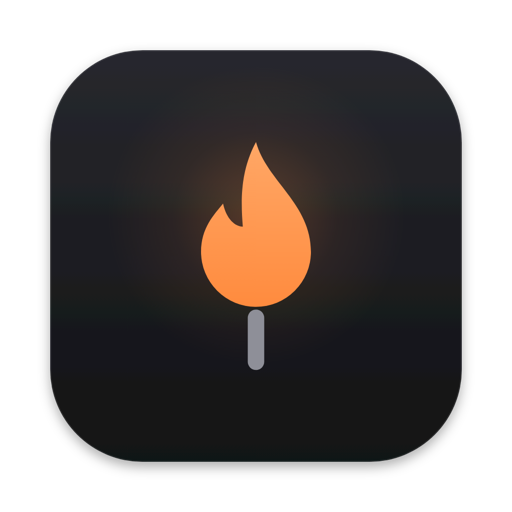
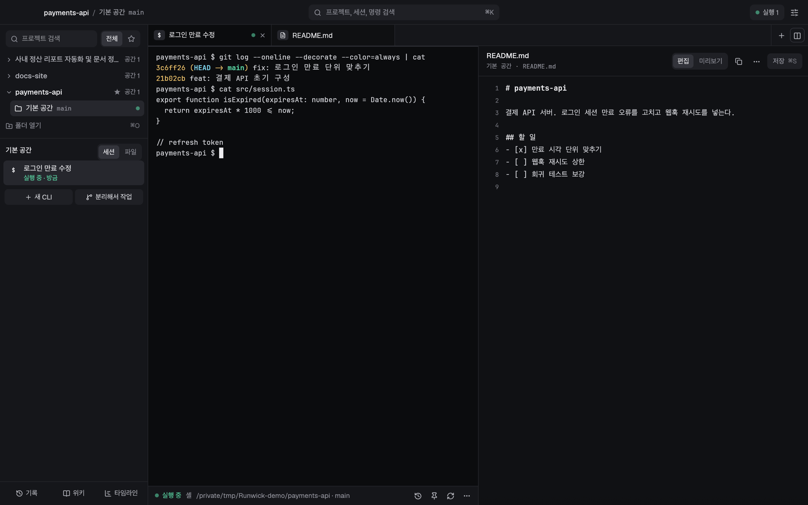
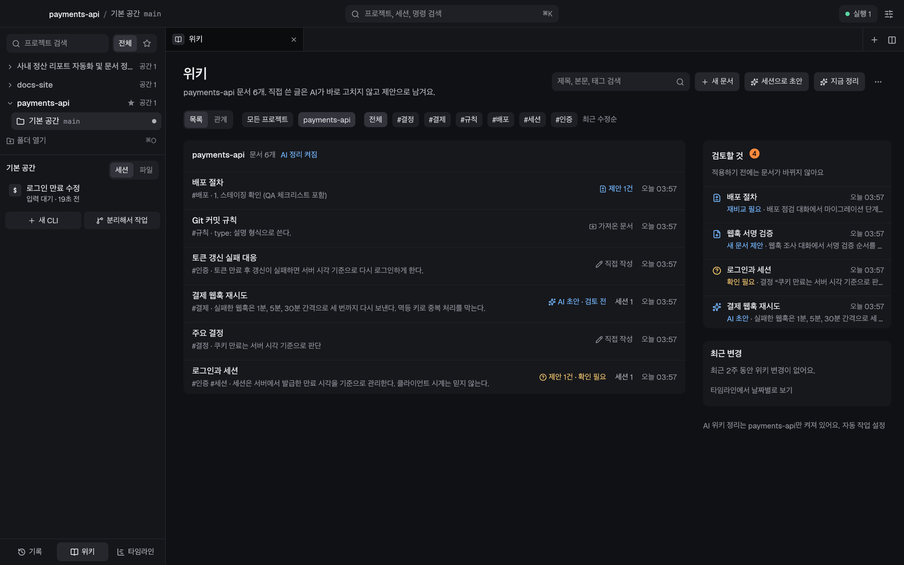
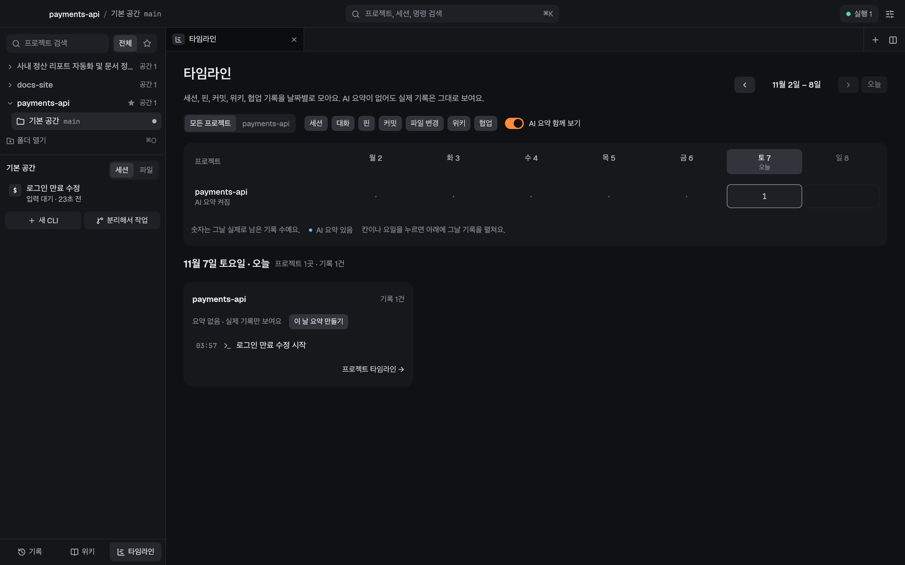

<p align="center">
  
</p>
<h1 align="center">Runwick · 런윅</h1>
<p align="center">AI 코딩 CLI의 실행과 기록을 한곳에서 이어 가는 macOS 네이티브 작업실</p>
<p align="center">
  <a href="https://gjeon03.github.io/runwick/">사이트</a> ·
  <a href="https://github.com/gjeon03/runwick/releases">다운로드</a> ·
  <a href="#english">English</a>
</p>



Runwick은 Claude Code·Codex·셸을 원래 CLI 화면 그대로 쓰면서, 프로젝트마다 실행과 대화 맥락을 이어 가는 앱입니다. Rust와 egui로 만들었으며 UI는 한국어입니다.

## 무엇을 하나요

- **터미널·실행 유지** — 프로젝트 → 작업 공간 → 세션으로 이동하고, 폴더를 열면 기본 공간에서 바로 시작합니다. 한글 입력·색·붙여넣기·마우스를 지원하며, 창을 닫아도 CLI 실행은 유지됩니다. 다시 열면 같은 실행에 연결하고 메뉴 막대에서 확인할 일과 실행 수를 봅니다.
- **기록·검색·핀** — CLI가 남기는 대화 파일을 읽어 기록을 만들고 한국어 부분 검색을 지원합니다. 메시지와 터미널 발췌를 핀으로 고정할 수 있습니다.
- **파일·문서** — 파일 트리와 이름 검색, Markdown·텍스트 편집과 미리보기, 코드 보기를 제공합니다. CLI가 같은 파일을 바꾸면 덮어쓰지 않고 3열 비교로 확인합니다.
- **위키·타임라인** — 프로젝트 위키, 링크 그래프, AI 변경 제안 검토, 날짜별 타임라인과 이어하기 카드를 제공합니다. AI 자동 정리는 프로젝트별로 켜야 실행되며, 배터리 사용 중에는 새 자동 분석을 보류합니다.
- **협업** — CLI 안에서 다른 CLI에 일을 맡기고 결과를 받습니다. 작업자 화면을 잠깐 보거나 입력권을 가져와 직접 대화할 수 있고, Git worktree로 작업을 분리하고 통합 충돌을 처리할 수 있습니다.
- **환경변수·새로고침** — 환경변수는 전체 공통 설정으로 관리하고 비밀값은 macOS 키체인에 저장합니다. 설정 변경은 같은 대화를 유지하는 세션 새로고침으로 적용합니다.
- **GitHub 백업·동기화** — 비공개 저장소에 기록·핀·위키·타임라인·역할·설정을 백업하고 다른 컴퓨터에서 이어 씁니다. 비밀값은 동기화에서 제외합니다.
- **여러 기기** — SSH로 다른 Mac의 Runwick에 연결해 같은 사이드바에서 원격 작업 공간을 사용합니다. 각 기기가 자신의 실행을 유지합니다. 실제 두 Mac 사이 연결은 [추가 검증이 필요합니다](#알려진-한계).

창을 닫는 것과 작업을 끝내는 것은 별개입니다. **작업까지 종료**는 관리 중인 실행이 실제로 멈췄는지 확인한 뒤 끝냅니다. 재부팅 후에는 기록과 마지막 화면을 복원하고, 재개할 세션은 사용자가 직접 고릅니다.





## 설치

**macOS 11 이상**이 필요합니다. Claude Code나 Codex를 사용하려면 해당 CLI를 별도로 설치해야 합니다.

1. [GitHub Releases](https://github.com/gjeon03/runwick/releases)에서 ZIP 파일을 다운로드합니다.
2. 압축을 풀고 `Runwick.app`을 `/Applications`로 옮깁니다.
3. 현재 배포 번들은 **ad-hoc 서명**을 사용합니다. 처음 실행할 때 Finder에서 앱을 우클릭하고 **열기**를 선택하세요. 실행이 차단되면 다음 명령으로 해당 앱의 격리 속성을 제거한 뒤 다시 엽니다.

```sh
xattr -dr com.apple.quarantine /Applications/Runwick.app
```

Developer ID 서명과 공증은 아직 적용하지 않았습니다.

## 소스에서 빌드

[rustup](https://rustup.rs)으로 설치한 **Rust stable**과 **Xcode 또는 Command Line Tools**가 필요합니다. 저장소 루트에서 실행하세요.

```sh
RUNWICK_HOME="$(mktemp -d)" cargo run -p runwick
sh scripts/bundle-macos.sh
```

첫 명령은 임시 데이터 폴더로 개발용 앱을 실행하며, 호스트는 자동으로 시작합니다. 두 번째 명령은 release 빌드와 ad-hoc 서명을 거쳐 `dist/Runwick.app`을 만듭니다. 평소 사용에는 이 번들을 사용하세요. 개발 중 번들을 시험할 때도 임시 `RUNWICK_HOME`을 사용합니다.

Xcode 사용권에 아직 동의하지 않았다면 링크 단계가 실패할 수 있습니다. `sudo xcodebuild -license accept`로 동의하거나, 명령 앞에 다음처럼 `DEVELOPER_DIR`를 지정해 Command Line Tools로 빌드합니다.

```sh
DEVELOPER_DIR=/Library/Developer/CommandLineTools sh scripts/bundle-macos.sh
```

워크스페이스 테스트:

```sh
RUNWICK_HOME="$(mktemp -d)" cargo test --workspace
```

## CLI 안에서 쓰는 명령

Runwick이 띄운 터미널에서는 `runwick` 명령이 `PATH`에 있습니다.

| 명령 | 내용 |
| --- | --- |
| `runwick delegate --tool codex "할 일"` | 다른 CLI에 일을 맡기고 작업자 ID 출력 |
| `runwick workers` · `runwick status` | 맡긴 작업자 목록과 협업 상태 확인 |
| `runwick wait <id>` · `runwick result <id>` | 완료 대기와 결과 확인: 요약·바뀐 파일·검증·남은 일 |
| `runwick send <id> "후속 지시"` | 자기 작업자에게 후속 지시 전달 |
| `runwick report --summary "…"` | 작업자가 결과 보고 |

## 데이터와 동기화

- **로컬 저장** — 데이터는 `~/.runwick`에 저장하며 폴더 권한은 `0700`입니다. 기록은 SQLite, 위키는 Markdown 파일로 보관합니다. `RUNWICK_HOME`으로 다른 위치를 지정할 수 있습니다.
- **GitHub 동기화** — 비공개 저장소에 기록·핀·위키·타임라인·역할·설정을 올립니다. 키체인에 저장한 비밀값은 제외하며, 다른 컴퓨터에서 받은 환경변수 값은 검토한 뒤에만 적용합니다.
- **겹친 변경** — 두 컴퓨터에서 같은 항목을 수정하면 적용되지 않은 쪽의 내용을 **겹친 변경**에 남깁니다.
- **로컬 백업** — 이 컴퓨터 디스크에 서명된 백업을 만들 수 있습니다.

프로젝트별 환경 설정은 `.env` 등 프로젝트 도구에서 관리합니다. Runwick의 환경변수 설정은 전체 공통입니다.

## 보안 범위

- 호스트 소켓과 데이터 폴더는 사용자 본인만 접근할 수 있습니다.
- 환경변수·동기화·백업·세션 입력은 Runwick 창만 수행할 수 있습니다. 호스트는 창 토큰, 연결한 프로세스가 Runwick 실행 파일인지, 관리 중인 CLI 실행에서 온 요청인지 확인합니다. 원격 연결은 SSH 로그인 여부도 확인합니다.
- CLI 안의 에이전트는 자기 세션의 협업 명령만 사용할 수 있습니다. 자기 작업자에게만 지시할 수 있으며, 다른 프로젝트나 세션에 접근할 수 없습니다.
- 동기화로 받은 환경변수는 검토 전까지 적용하지 않습니다. 호스트가 프로젝트 폴더에서 Git을 실행할 때는 저장소 설정의 hook·fsmonitor·filter를 끕니다.
- **완전한 격리는 아닙니다.** 같은 사용자로 실행되는 프로그램은 키체인과 데이터 파일을 직접 읽을 수 있습니다. 이 경계는 실수와 프롬프트 주입을 줄이기 위한 장치입니다.
- Runwick 터미널 안에서 띄운 Runwick 창에는 창 권한을 부여하지 않습니다. 개발 중 앱 창은 `open`이나 Finder로 실행하세요.
- `scripts/bundle-macos.sh`로 만든 번들은 hardened runtime으로 서명하며 검증용 훅을 제외한 release 빌드입니다. `cargo run` 개발 빌드에는 이 보호가 없으므로 임시 `RUNWICK_HOME`과 함께 사용하세요.

## 구조

| 경로 | 역할 |
| --- | --- |
| [crates/runwick-core](crates/runwick-core) | 통신 규격·기능별 API 타입·데이터 경로·터미널 출력 안전장치 |
| [crates/runwick-host](crates/runwick-host) | 실행 호스트: PTY·터미널 상태·SQLite·기록 수집·위키·타임라인·자동 작업·협업·동기화·백업·기기 |
| [crates/runwick-app](crates/runwick-app) | egui UI: 제목 막대·사이드바·탭·패널·터미널·기능별 화면 |
| [crates/runwick](crates/runwick) | 실행 파일: 앱·`host`·`menubar`·에이전트용 하위 명령 |
| [assets](assets) | 앱 아이콘과 글꼴·아이콘 자산(Geist·JetBrains Mono·Lucide, 각 라이선스 동봉) |

## 문서

기획 문서와 디자인 시안에는 구현 전 제안이 포함되어 있습니다. 확정된 결정과 구현 상태, 남은 검증은 [결정 기록](docs/decisions.md)에서 구분합니다. 이 README의 구현 설명은 [`5bc1616`](https://github.com/gjeon03/runwick/commit/5bc1616)을 기준으로 합니다.

| 문서 | 내용 |
| --- | --- |
| [결정 기록](docs/decisions.md) | 사용자 결정·구현 기술 선택·남은 검증 |
| [UI 디자인 시안](docs/design/README.md) | 51개 흐름 화면과 공통 부품, Graphite Wick 시각 기준 |
| [전체 제품 기획](docs/product-spec.md) | 제품 범위와 기록·지식·설정·책임 경계 |
| [협업·오케스트레이션](docs/orchestration.md) | 위임·입력권·작업 공간·결과·실패·복구 |
| [화면 명세](docs/ui-spec.md) | 화면과 패널의 정보·행동·상태·반응형 |
| [사용 흐름·수용 기준](docs/user-flows.md) | 사용 흐름·예외 처리·검증 기준 |
| [제품 방향](docs/product-direction.md) | 사용 흐름과 차별점 가설 |
| [데이터 이전 검토](docs/data-migration.md) | 초기 설계 검토 기록이며 앱 기능에는 포함되지 않음 |
| [Herdr 조사](docs/research/herdr.md) · [협업 코드 비교](docs/research/collaboration-models.md) · [원격 조사](docs/research/orca-remote.md) · [세션 새로고침 조사](docs/research/session-refresh.md) | 설계 근거와 검증 과제 |

## 알려진 한계

- **배포 서명** — 현재 번들은 ad-hoc 서명과 hardened runtime을 사용합니다. Developer ID 서명·공증과 자동 업데이트는 아직 준비되지 않았습니다.
- **원격 연결 검증** — 실제 두 Mac 사이 SSH 연결 성공 경로는 시뮬레이션 기기와 단위 테스트로만 확인했습니다. 개발에 사용한 Mac은 원격 로그인이 꺼져 있습니다.
- **세션 새로고침 검증** — 실제 Claude Code의 `--resume` 경로는 토큰 사용 때문에 가짜 CLI 테스트로 확인했습니다. 실제 CLI로의 추가 검증이 필요합니다.
- **분리된 프로세스** — 실행 종료 시 세션에서 완전히 떨어져 나간 프로그램은 종료하지 않고 **계속 실행 중**으로 알립니다. Codex 공유 서버 같은 프로그램을 보호하기 위한 동작입니다. 다만 Apple 기본 프로그램(예: `/usr/bin/perl`)으로 떨어져 나간 경우에는 macOS가 정보를 숨겨 알리지 못합니다.
- **Git 설정 경쟁** — 호스트가 저장소 설정의 실행 항목을 끄더라도, 같은 순간에 설정 파일을 바꿔 치는 경쟁은 완전히 막지 못합니다. 해당 폴더에 쓸 수 있는 프로그램이 계속 경쟁하는 경우에 해당합니다.
- **Codex 상태 표시** — 입력창에 번호 목록을 쓰는 동안에는 전송 전까지 **선택 필요**로 보일 수 있습니다.
- **미구현 범위** — 밝은 테마, 모바일 앱, 의미 검색(임베딩)은 제공하지 않습니다.

## 라이선스

[MIT License](LICENSE) · Copyright (c) 2026 gjeon03. 동봉한 글꼴과 아이콘 자산에는 각 자산의 라이선스가 적용됩니다.

## English

Runwick is a macOS-native workroom for Claude Code, Codex, and shell sessions, built with Rust and egui. It keeps the original CLI experience while organizing projects, workspaces, conversations, and files in one place. The UI is in Korean.

- Keep CLI runs alive after closing the window; reconnect when you reopen it.
- Search conversation history, pin messages, and browse or edit Markdown and text files.
- Review project wikis, link graphs, and timelines, with opt-in AI organization.
- Delegate work between CLIs and separate work with Git worktrees.
- Back up and sync records through a private GitHub repository, excluding stored secrets.
- Access another Mac's workspaces over SSH; real two-Mac connectivity still needs validation.

**Install:** Download the ZIP from [Releases](https://github.com/gjeon03/runwick/releases), move `Runwick.app` to `/Applications`, then right-click → Open on first launch (ad-hoc signed; not notarized). If blocked, run `xattr -dr com.apple.quarantine /Applications/Runwick.app`. Requires macOS 11+ and separately installed Claude Code and/or Codex CLI to use those tools. See [known limitations](#알려진-한계) before use.
