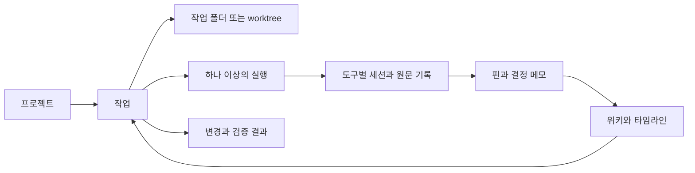

# Runwick 제품 방향 초안

상태: **세부 제품 구성은 검토용 제안. 네이티브 GUI·기존 CLI·대화 검색·핀·파일 탐색 및 문서 편집 방향은 확정** · 2026-11-05

Runwick의 가치 후보는 “여러 AI와 진행하는 일을 잃지 않고 이어가는 가벼운 작업 공간”이다. Herdr에서 배울 실행·전환·주의 관리와 Pinloom에서 유용했던 기록·환경·지식을 하나의 일 흐름으로 연결한다.

## 해결할 사용자 문제

| 상황 | 원하는 경험 |
| --- | --- |
| 프로젝트마다 환경 설정을 반복함 | 사용할 설정을 선택하고 바로 실행 |
| 여러 세션이 동시에 진행됨 | 실행 중인 일과 내가 답해야 할 일을 구분 |
| 창이 닫히거나 프로그램이 종료됨 | 살아 있는 실행에 재연결하거나 복구 가능한 지점 표시 |
| 며칠 뒤 돌아오면 맥락을 잊음 | 마지막 변경, 결정 이유, 남은 일, 관련 세션을 함께 확인 |
| 중요한 대화를 다시 찾기 어려움 | 특정 대화를 핀으로 고정하고 세션·프로젝트를 넘어 검색 |
| 문서 확인·수정마다 다른 앱으로 이동함 | 프로젝트 파일을 탐색하고 터미널 옆에서 가볍게 편집 |
| 요약·위키·임베딩 작업이 보이지 않음 | 실행 이유·상태·마지막 결과와 중지 수단 확인 |
| 개인 기능을 유지하느라 업데이트가 어려움 | CLI 원래 기능을 활용하고 제품 고유 기능의 경계를 좁힘 |

## 권장하는 작업 흐름

프로젝트를 찾고, 작업 목적을 정한 뒤 기존 폴더나 별도 worktree에서 Claude Code·Codex 등의 도구를 실행한다. 기다리는 동안 다른 작업으로 전환하고, 입력이나 검토가 필요할 때 돌아온다. 변경과 검증 결과를 확인한 다음 결정·메모·관련 세션을 남겨 다시 이어간다.

아래는 이 흐름을 설명하는 개념 모델이다. 구현 모듈이나 DB 스키마로 확정한 것은 아니다.

작업은 실행이 종료되어도 남는다. 한 작업에 여러 실행 시도와 여러 에이전트가 연결될 수 있다. 기존 Pinloom 세션을 가져올 때는 과거 세션에 작업 관계가 없다는 사실을 그대로 표현하고, AI가 관계를 임의로 확정하지 않는다.

## CLI와 기록 패널의 역할 제안

대화·도구 실행·CLI 고유 조작은 기존 터미널에서 수행한다. Runwick에는 필요할 때 여는 기록 패널을 두어 과거 대화를 메시지 단위로 읽고 검색·핀 고정을 할 수 있게 한다. 기록 패널에서 새로운 대화를 보내거나 CLI의 승인 UI를 다시 구현하는 것은 이 제안에 포함하지 않는다.

| 사용자 행동 | 제안하는 동작 |
| --- | --- |
| 방금 나온 중요한 답변 보관 | 기록 패널에서 메시지 또는 일부 문장을 핀으로 고정 |
| 터미널에서 선택한 문장 보관 | 선택 텍스트를 발췌 핀으로 저장. 메시지를 확실히 식별할 수 있을 때 원문에 연결 |
| 현재 대화에서 문구 찾기 | 해당 세션의 저장된 대화에서 키워드 검색 |
| 어느 세션인지 기억나지 않음 | 전체 또는 프로젝트 범위 검색, 세션·날짜·도구별 필터 |
| 검색 결과 또는 핀 열기 | 기록 패널에서 해당 메시지와 앞뒤 대화를 열고 검색어 강조 |

기록을 여는 동작은 실행 중인 CLI의 입력·스크롤을 바꾸지 않는다. 오래된 메시지가 현재 터미널 버퍼에서 사라졌어도 이미 수집한 기록은 별도로 열람할 수 있어야 한다. 기록의 위치로 이동하는 것과 CLI 세션을 재개하는 동작은 구분한다.

핀에는 보관할 본문과 출처를 함께 저장하는 안을 권장한다. 출처에는 프로젝트·세션·도구·원문 시각·메시지 식별자를 포함하되, 터미널 발췌를 특정 메시지에 연결할 수 없다면 그 사실을 표시한다. 같은 문구가 여러 번 나왔다는 이유만으로 원문 관계를 추정해 확정하지 않는다.

기술적으로 터미널 출력과 검색 가능한 대화 기록은 별도로 다뤄야 한다. Claude·Codex별로 제공되는 기록 또는 이벤트를 읽어 변경분을 수집하는 어댑터를 검토한다. CLI마다 수집 가능한 범위와 지연이 다를 수 있으므로 원문 연결·중복 방지·중단 후 재수집을 먼저 검증한다. 화면 문자열만으로 완전한 대화 이력을 확보했다고 가정하지 않는다.

기본 키워드 검색과 핀은 AI 요약·임베딩 없이 작동하도록 설계하는 안을 권장한다. 한국어 문구·부분 일치·코드 기호 검색을 검증하고, 의미 검색은 별도 확장으로 판단한다. 기록 수집 실패와 마지막 수집 시각을 표시해 검색 결과가 실제 전체 기록인지 사용자가 판단할 수 있게 한다.

## 파일 탐색과 가벼운 편집

같은 프로젝트 안에서 왼쪽 사이드바의 세션·파일 보기를 전환하고, 중앙에는 CLI 터미널과 열린 문서를 탭으로 표시한다. 기록·검색·핀은 필요할 때 여는 오른쪽 패널로 연결한다. 문서 탭을 보거나 탐색 방식을 바꾸어도 실행 중인 CLI는 유지한다. 터미널과 문서를 나란히 보는 배치도 구체화한다.

합의한 방향을 바탕으로 다음 범위를 검증한다.

- 폴더·파일 트리와 파일명 검색.
- Markdown·일반 텍스트 편집, Markdown 미리보기.
- 코드 파일 열람·구문 강조, 경로 복사·외부 에디터 열기.
- 한글 입력, 실행 취소, 저장 상태 표시.
- AI 등 외부 프로세스가 파일을 수정했을 때 변경 감지. 저장하지 않은 편집이 있으면 자동 덮어쓰기 없이 비교·해결하는 흐름.

자동완성·디버거·확장 프로그램은 이후 판단한다. 작업 공간을 분리하는 구조를 채택하면 파일 트리와 문서 탭은 선택한 작업 공간의 실제 폴더에 연결해야 한다. 작업 공간 모델 자체는 아직 논의 중이다.

## 상태를 나누어 보여주는 제안

| 상태 축 | 예시 | 구분하는 이유 |
| --- | --- | --- |
| 실행 | 실행 중, 입력 대기, 종료, 연결 끊김, 상태 미확인 | CLI 또는 프로세스의 실제 상태 |
| 사용자 확인 | 승인 필요, 답변 필요, 새 결과 있음, 확인 완료 | 지금 사용자가 해야 할 행동 |
| 결과 검토 | 미검토, 수정 필요, 검증 실패, 검토 완료 | 에이전트가 멈춘 것과 일이 끝난 것은 다름 |

보고되지 않은 상태를 정상 대기로 간주하지 않는다. 승인 버튼은 해당 실행의 현재 요청에 연결되어야 한다. 오래된 화면의 승인이 다른 프롬프트에 입력되지 않도록 설계한다.

## 첫 버전 범위 제안

- 프로젝트 검색·즐겨찾기와 CLI 실행, 세션 재개.
- 환경 설정 선택, 도구별 기록 수집, 원문 검색·핀·수동 이어하기 메모.
- 프로젝트 파일 탐색·파일명 검색, 가벼운 문서 편집과 코드 열람.
- worktree 생성과 세션 연결, 입력 대기·완료 알림.
- 현재 실행 및 백그라운드 작업을 확인하고 중지하는 화면.
- Pinloom 기록을 읽기 전용으로 시험 가져오기하고 누락 보고서를 확인하는 기능.

위키·타임라인은 첫 버전에서 기존 문서를 읽고 찾는 경험을 우선 검증하고, 자동 생성은 이후 독립된 작업으로 추가하는 안을 권장한다. 일정·Teams 전체 재구현·원격 실행·디자인/기획 에이전트는 첫 버전 범위로 확정하지 않는다.

## UI 선택과 비교 기록

사용자는 Rust 기반 네이티브 GUI를 선택했다. 아래는 선택 당시 비교한 접근법이다.

| 선택지 | 장점 | 부담 |
| --- | --- | --- |
| 네이티브 GUI부터 | 여러 터미널, 변경 검토, 위키·타임라인을 한 공간에서 다루기 좋음 | 터미널 렌더러, 한글 IME, 접근성, 배포 검증 필요 |
| TUI부터 | 키보드 중심 탐색과 기존 터미널 사용에 적합 | 중첩 터미널, 마우스·복사, 긴 문서와 여러 화면 동시 확인 부담 |
| 공통 코어와 GUI·TUI 동시 개발 | 다양한 진입점 | 초기 구현과 검증 범위가 가장 큼 |

첫 제품은 네이티브 GUI로 구성한다. 코어와 화면의 경계는 설계 과정에서 정하고, 구체적인 UI 프레임워크는 한글 입력·터미널 동작·성능을 확인하는 짧은 실행 실험으로 판단한다.

## 가벼움과 안정성을 평가할 기준

Rust 사용 자체를 성능 증거로 삼지 않는다. 같은 기기·같은 출력량·같은 세션 수로 시작 시간, 입력 지연, 유휴 CPU, 프로세스 전체 메모리, 숨긴 터미널 출력 부하를 측정한다. 앱과 코어, 하위 CLI 프로세스 수치를 구분한다. 수치 목표는 기준 측정 후 정한다.

백그라운드 작업은 이름·시작 이유·진행 상태·최근 결과·재시도 여부를 표시한다. 자원 사용량은 측정 가능한 범위를 표시하고, LLM 비용은 제공자가 제공한 실제 사용량과 추정을 구분한다. 배터리 사용 중 정책과 자동 실행 범위는 사용자 설정으로 검토한다.

복구 검증은 창 닫기, UI 충돌, 코어 충돌, 실행 관리자 종료, OS 재시작을 나누어 진행한다. 살아 있는 PTY에 재연결하는 것, 새 CLI에서 provider 세션을 재개하는 것, 과거 기록을 읽는 것은 각각 별개의 기능이다.

## 구현 계획 전 확인할 질문

1. 첫 화면에서 가장 중요한 것은 프로젝트 목록, 진행 중 작업, 확인 요청 중 무엇인가?
2. 검색·핀·원문 열람을 작업을 방해하지 않고 어떻게 열고 닫게 할 것인가?
3. CLI별 재개 ID·기록·작업 상태를 어느 수준까지 안정적으로 얻을 수 있는가?
4. Pinloom의 실제 데이터 중 먼저 가져와야 매일 사용할 수 있는가?

근거: [Herdr 조사](research/herdr.md), [Pinloom 검토](research/pinloom.md), [데이터 이전 제안](data-migration.md).
